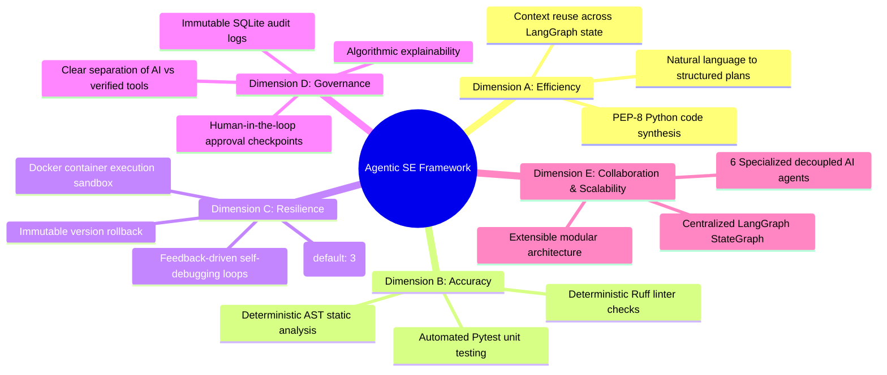
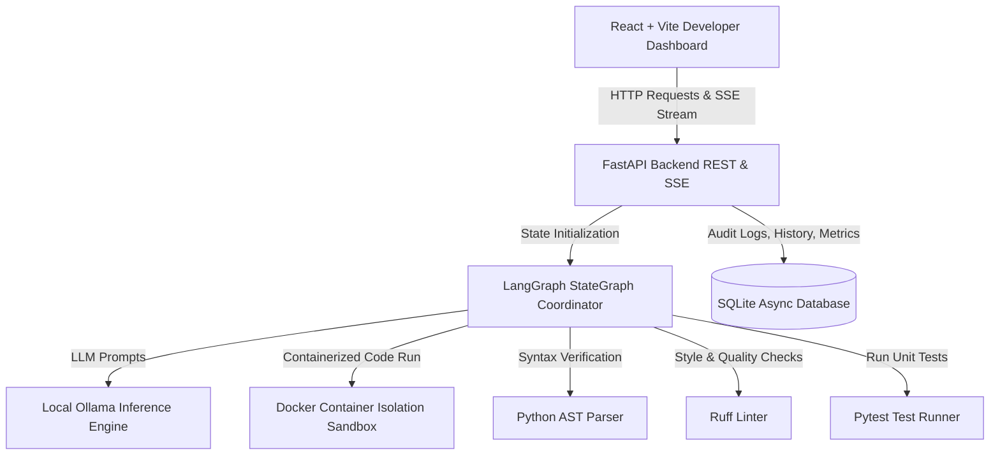
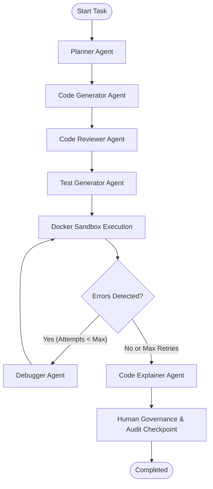

# Agentic AI-Powered Autonomous Software Engineering Framework for Automated Code Generation and Debugging

A complete, functional, modular, open-source multi-agent software engineering framework developed for B.Tech final-year academic research, based on the research paper:

> **"Agentic AI-Powered Autonomous Software Engineering Framework for Automated Code Generation and Debugging"**  
> *Scientific Culture, Volume 12, Number 1.1, 2026.*

---

## 1. Project Background & Research Dimensions

Modern software engineering demands high efficiency, code correctness, and rapid error recovery. Traditional code-completion LLMs lack autonomy, architectural planning, deterministic verification, and transparent accountability.

This framework reflects the **five core research dimensions** established in the foundational paper:



---

## 2. System Architecture



---

## 3. The Six Specialized AI Agents

Every agent runs as an independent Python module with dedicated structured schemas and prompts:

| Agent | Python Module | Role & Core Responsibility |
|-------|---------------|----------------------------|
| **1. Planner Agent** | `app.agents.planner` | Translates natural language requirements into decomposition steps, functional requirements, constraints, and edge cases. |
| **2. Code Generator Agent** | `app.agents.code_generator` | Generates PEP-8 compliant Python code with type hints, docstrings, and robust error handling. |
| **3. Code Reviewer Agent** | `app.agents.code_reviewer` | Runs deterministic AST checks and Ruff linting alongside AI reasoning to identify bugs, security concerns, and maintainability scores. |
| **4. Test Generator Agent** | `app.agents.test_generator` | Synthesizes Pytest test suites covering normal inputs, edge conditions, invalid values, and exceptions. |
| **5. Debugger Agent** | `app.agents.debugger` | Performs root-cause analysis on execution tracebacks and applies validated, minimal fixes within bounded retry loops. |
| **6. Code Explainer Agent** | `app.agents.explainer` | Generates algorithmic breakdowns, function-by-function complexities (O(n)), execution flow traces, and key concepts. |

---

## 4. Multi-Agent Workflow State Diagram



---

## 5. Technology Stack

- **Frontend**: React 19, Vite, Tailwind CSS v4, React Router v7, CodeMirror 6, Lucide React, Recharts.
- **Backend**: Python 3.14, FastAPI, Pydantic v2, SQLAlchemy 2.0 (async), aiosqlite, Uvicorn.
- **Agentic AI**: Official Ollama Python SDK, LangGraph StateGraph, zero paid APIs.
- **Deterministic Analysis & Safety**: Python AST, Ruff, Pytest, Docker container isolation.

---

## 6. Getting Started

### 1. Hardware Inspection & Model Recommendation
For systems with **8 GB RAM and 4 GB GPU VRAM (NVIDIA)**:
- **Recommended Model**: `qwen2.5-coder:1.5b` (Download: ~1.0 GB, VRAM usage: ~1.8 GB). Fits 100% inside GPU VRAM for fast generation.
- **Alternative**: `qwen2.5-coder:3b` (Download: ~2.0 GB).

### 2. Ollama Setup
1. Install Ollama from [https://ollama.com](https://ollama.com).
2. Start the service:
   ```bash
   ollama serve
   ```
3. Pull the recommended coding model:
   ```bash
   ollama pull qwen2.5-coder:1.5b
   ```

### 3. Backend Setup
```bash
cd backend
python -m venv venv
.\venv\Scripts\activate
pip install -r requirements.txt
python -m pytest tests -v
python -m uvicorn app.main:app --host 0.0.0.0 --port 8000 --reload
```
Interactive API documentation will be available at `http://localhost:8000/docs`.

### 4. Frontend Setup
```bash
cd frontend
npm install --legacy-peer-deps
npm run build
npm run dev
```
Open `http://localhost:5173` in your browser.

---

## 7. The 10 Dashboard Views

1. **Dashboard**: Quantitative empirical metrics across all 5 research dimensions, Recharts visual analytics, and recent workflow activity.
2. **AI Code Generator**: Natural language input with example chips, real-time agent execution progress, CodeMirror editor, copy, and download.
3. **Agent Workflow**: Live view of all 6 agents with status badges, durations, summaries, and a live Server-Sent Events (SSE) terminal.
4. **Code Debugger**: Execution output, error tracebacks, root-cause diagnosis, before/after diffs, and accept/reject controls.
5. **Automated Tests**: Pytest test cases, passed/failed counters, and live test runner console.
6. **Code Review**: Separate deterministic findings (AST & Ruff) from AI observations, quality ratings, and security recommendations.
7. **Explainability**: High-level program overview, function-by-function complexities, and execution traces.
8. **Governance & Audit**: Full audit logs, decision histories, and human approval checkpoints.
9. **Projects & History**: Project workspaces, code version snapshots, and one-click rollbacks.
10. **Settings**: Ollama endpoint, model selector, Docker status, and execution timeouts.

---

## 8. Verification & Test Suite

The test suite validates:
- Health check endpoints and component diagnostics.
- Independent execution of all 6 agents with mock LLM outputs.
- Deterministic AST static analysis and bare-except / docstring detection.
- LangGraph conditional routing logic (debugger loopback & retry bounding).

Run the tests at any time:
```bash
cd backend
.\venv\Scripts\python -m pytest tests -v
```

---

## 9. Academic License & Citation

Released under the **MIT License** for academic, research, and educational purposes.
