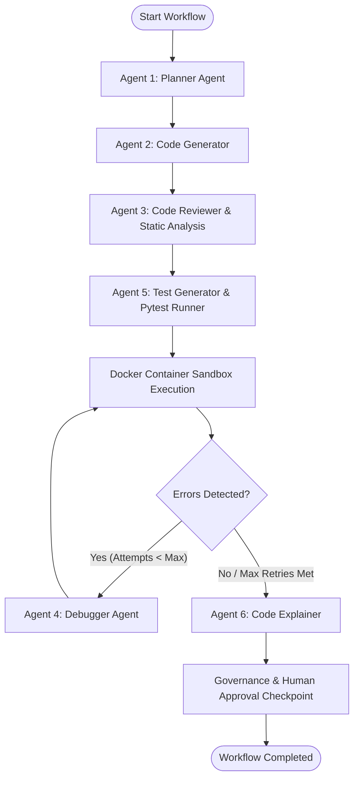

# Multi-Agent Workflow Specification

## 1. Agent Roles & Specifications

The framework organizes 6 distinct specialized agents:

### 1. Planner Agent (`app.agents.planner`)
- **Objective**: Translate natural-language requirements into an actionable specification.
- **Inputs**: User prompt requirement string.
- **Outputs**: Structured JSON plan including problem understanding, functional requirements, technical constraints, decomposition steps, required functions, and edge cases.
- **Role**: Coordinates initial task scoping in LangGraph.

### 2. Code Generator Agent (`app.agents.code_generator`)
- **Objective**: Synthesize production-ready Python source code.
- **Inputs**: Implementation plan and user requirements.
- **Outputs**: Python code adhering to PEP 8 standards with type hints, docstrings, and error handling.

### 3. Code Reviewer Agent (`app.agents.code_reviewer`)
- **Objective**: Review code for syntax, security, maintainability, and quality issues.
- **Dual Pipeline**:
  - Deterministic AST Analysis (`app.services.analysis_service`): catches missing docstrings, excessive parameters, bare except blocks, and improper identity comparisons.
  - Deterministic Ruff Linter: catches style violations and PEP 8 issues.
  - LLM Review: analyzes semantic logic, edge cases, and architectural maintainability.
- **Outputs**: Separated deterministic findings and AI suggestions.

### 4. Test Generator Agent (`app.agents.test_generator`)
- **Objective**: Synthesize comprehensive unit test suites using Pytest.
- **Test Categories**:
  - `normal`: Typical inputs and standard operations.
  - `edge`: Boundary values, empty inputs, zeros, large numbers.
  - `invalid`: Type mismatches and exception assertions (`pytest.raises`).
- **Outputs**: `test_code`, test cases list, and execution results via `app.services.testing_service`.

### 5. Debugger Agent (`app.agents.debugger`)
- **Objective**: Automatically diagnose failures and apply minimal, correct fixes.
- **Debugging Cycle**:
  1. Receive failing code and traceback/error details.
  2. Analyze root cause and categorize error (`syntax`, `runtime`, `logical`, `type`, etc.).
  3. Formulate minimal working correction.
  4. Verify proposed fix with deterministic AST syntax parsing.
  5. Return corrected code to the LangGraph execution loop for re-validation.
- **Bounded Iterations**: Configurable maximum attempts (default: 3) to prevent infinite loops.

### 6. Code Explainer Agent (`app.agents.explainer`)
- **Objective**: Provide pedagogical explainability and transparency.
- **Outputs**: Program overview, function-by-function walkthrough with time/space complexities, execution trace, and key concept highlights.

---

## 2. LangGraph State Machine Workflow

