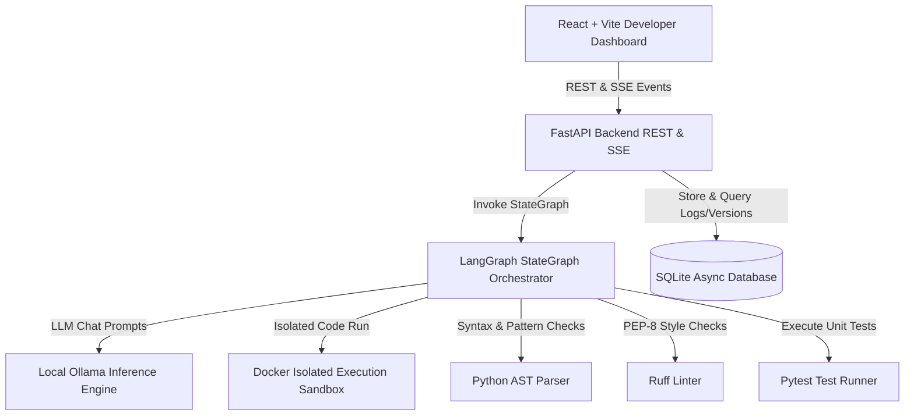

# System Architecture & Technical Design

## 1. High-Level Architecture Overview

The **Agentic AI Software Engineering Framework** is an autonomous multi-agent system designed for automated code generation, deterministic static analysis, unit testing, self-debugging, and explainability with human-in-the-loop governance.

The system is structured as a modular client-server architecture:
- **Presentation Layer**: React.js SPA powered by Vite, Tailwind CSS, CodeMirror 6, Lucide icons, and Recharts.
- **API & Application Layer**: FastAPI backend with Pydantic schemas, dependency injection, and Server-Sent Events (SSE).
- **Agentic Orchestration Layer**: LangGraph StateGraph managing a shared typed workflow state across 6 specialized agents.
- **Deterministic Tool Layer**: Python AST parser, Ruff linter, and Pytest test runner.
- **Isolated Execution Engine**: Docker container sandbox with memory limits (256MB), CPU limits (50%), dropped capabilities, and disabled network access.
- **Persistence Layer**: SQLite with async SQLAlchemy 2.0 and aiosqlite for audit trails, versions, and metrics.



---

## 2. Shared Typed Workflow State (`WorkflowState`)

The central coordination mechanism across all agents is LangGraph's typed state:

```python
class WorkflowState(TypedDict, total=False):
    task_id: str
    project_id: Optional[str]
    model: Optional[str]
    user_requirement: str
    implementation_plan: Optional[Dict[str, Any]]
    generated_code: Optional[str]
    code_filename: Optional[str]
    code_version: int
    review_results: Optional[Dict[str, Any]]
    static_analysis_results: Optional[Dict[str, Any]]
    test_code: Optional[str]
    test_results: Optional[Dict[str, Any]]
    execution_results: Optional[Dict[str, Any]]
    has_errors: bool
    error_details: Optional[str]
    debugging_attempts: int
    max_debug_attempts: int
    corrected_code: Optional[str]
    debugging_history: List[Dict[str, Any]]
    approval_status: Optional[str]
    explanation: Optional[Dict[str, Any]]
    agent_statuses: Dict[str, Dict[str, Any]]
    workflow_status: str
    execution_logs: List[str]
```

---

## 3. Five Research Dimensions Alignment

| Dimension | Architectural Implementation |
|-----------|------------------------------|
| **A. Efficiency** | Natural language to structured plan decomposition; reusable context in LangGraph; reduced manual coding iterations. |
| **B. Accuracy** | Deterministic AST parsing + Ruff linting combined with LLM semantic review; automated Pytest test generation and verification. |
| **C. Resilience** | Feedback-driven debugging loop; bounded retries (default max 3); rollback to previous version snapshots; graceful fallback when Ollama is offline. |
| **D. Governance** | Granular immutable audit logs for every agent execution; human-in-the-loop approval checkpoints; transparent algorithmic explanations without exposing internal CoT. |
| **E. Scalability & Collaboration** | 6 independent specialized agents (Planner, Generator, Reviewer, Debugger, Test Generator, Explainer) modularly decoupled inside LangGraph. |
